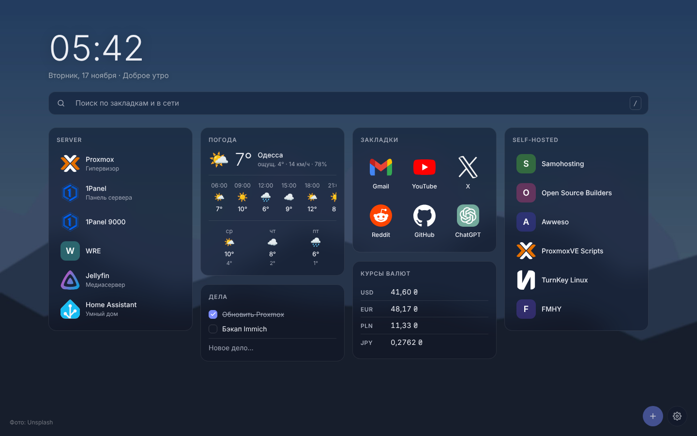
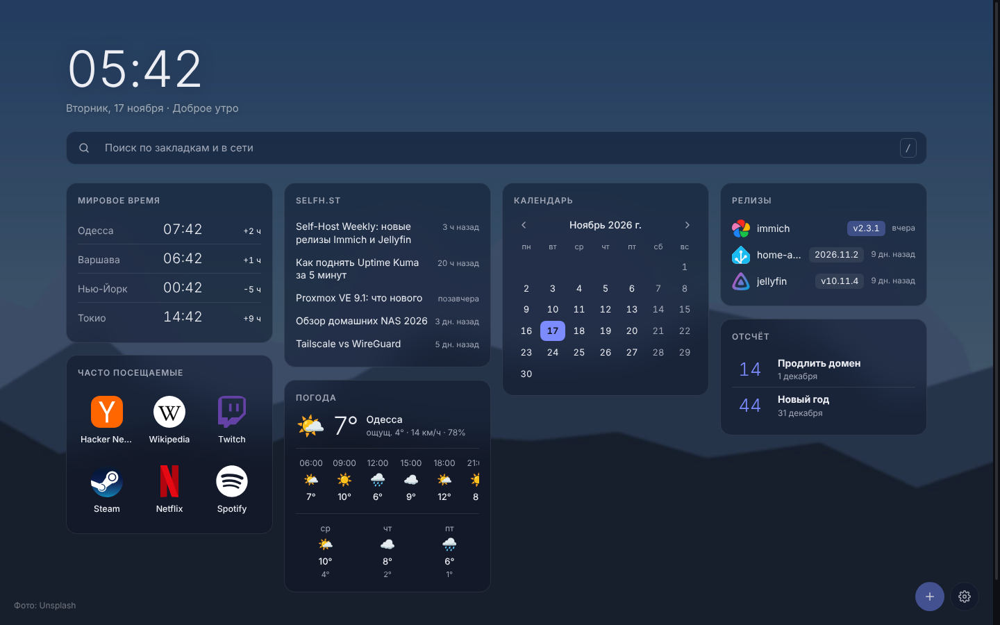
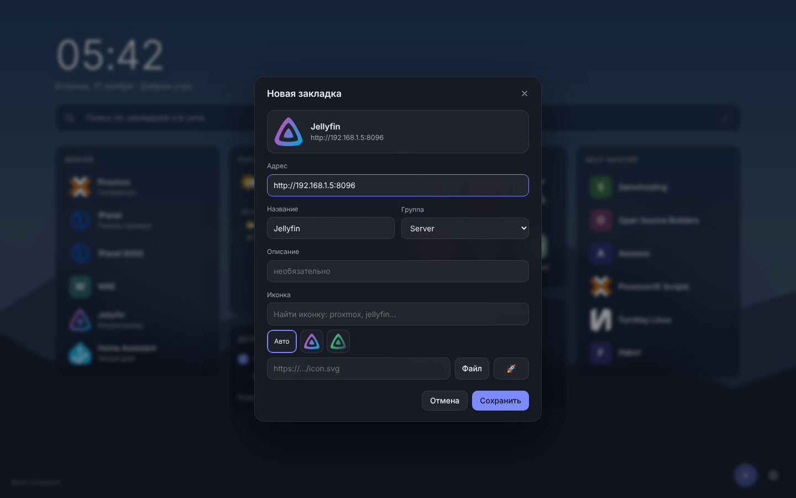

# R.Db — homelab desk for your new tab



| Widgets | Adding a bookmark |
|---|---|
|  |  |

A minimal dashboard in the spirit of Homepage, Homarr and Dashy — but as a browser extension.
No Docker, no server, no account: everything lives in your browser.

## What it does

- **Bookmark groups** in a packed grid. Each group can be shown as tiles, a list with descriptions (Homepage-style) or compact rows. Group width: 1–3 columns or full width.
- **Icons and titles by themselves.** Paste `http://192.168.1.10:8096` and you get *Jellyfin* with its logo. Matching uses the title, the hostname (`pve.lan`, `sonarr.home.example.com`) and default ports (8006 → Proxmox, 8123 → Home Assistant, 2283 → Immich…). An offline index covers ~4,300 self-hosted and popular services ([dashboard-icons](https://github.com/homarr-labs/dashboard-icons) + [selfhst/icons](https://github.com/selfhst/icons)). Public sites also get a title and description through microlink; anything else falls back to the site's favicon, then to a colored letter.
- **Adding bookmarks takes one step:**
  - the extension button → adds the current tab (title and group are editable);
  - right-click on any page or link → *Add to R.Db desk*;
  - `Ctrl+V` a link on the desk (it goes into the group under your cursor);
  - drag a link from the address bar or another page onto a group;
  - import a whole folder from browser bookmarks.
- **Desks:** several boards as tabs above the grid (Home, Work, Media…). Move a group to another desk from its menu or by dragging it onto a tab.
- **13 widgets:**
  - **server** — CPU, RAM, disks and uptime from Glances, Netdata or Proxmox (all nodes, running VMs/containers);
  - weather with hourly and daily forecast (Open-Meteo);
  - exchange rates with the previous value and change in amount and % — vs yesterday, a week or a month ago ([exchange-api](https://github.com/fawazahmed0/exchange-api)), crypto (CoinGecko);
  - world clock (`Home=Europe/Kyiv` for custom labels), calendar, countdown to dates;
  - RSS/Atom feed — access is asked only for that one site;
  - embedded page (Grafana, Uptime Kuma…; YouTube and Vimeo links turn into the player). Sites that forbid framing (`X-Frame-Options`) work too: grant access to that one site and the extension drops the header, only for frames inside its own page;
  - GitHub releases — latest versions of the apps you self-host, fresh ones highlighted;
  - most visited sites (right-click one to pin it to a group);
  - notes and to-do lists.
- **Keyboard:** `Space` puts letters on every visible link — type one to open it (`Shift` — in a new tab); `Space`, `1–9` or `Shift+←/→` switch desks.
- **Search:** type anywhere, or press `/`. It searches your bookmarks first, then the web (Google, DuckDuckGo, Bing, Yandex, Brave, Startpage, Perplexity or your own URL).
- **Server status:** a small dot on the icon — green is up, red is down (checked every minute while the tab is visible). By default only local addresses are checked; switch to *All links* or *Off* in settings, or per bookmark. Optionally the check also runs in the background: the extension icon shows how many servers are down, or you get a notification when one goes down and comes back.
- **Drag & drop:** grab a group by its header — the others make room as you move, `Esc` cancels; drag a group's right edge to change its width. Links can be dragged between groups. Right-click menu everywhere, undo after delete, layout lock.
- **Look:** dark, light or system theme; 90+ hand-picked Unsplash landscapes shown in random order without repeats, your own image links or file, colors and gradients; blur, dimming, accent color, density, page width, column count.
- **Sync** via your browser account (Chrome Sync / Firefox Sync), JSON export/import, RU/EN.
- **Upgrade from R.Db 1.x** is automatic: folders become groups, loose links go into *Bookmarks*, and widgets carry over.

## Install

**Chrome / Edge / Brave:** `chrome://extensions` → Developer mode → *Load unpacked* → the project folder.

**Firefox (121+):** `about:debugging` → This Firefox → *Load Temporary Add-on* → `release/firefox/manifest.json` (or the `.xpi`).
A temporary add-on is removed on restart. For a permanent install, upload `release/rdb-<version>-firefox.zip` to
[addons.mozilla.org](https://addons.mozilla.org/developers/) — choose *On your own* to get a signed `.xpi` for yourself without a public listing (free).

### Building a release

```bash
python tools/build-release.py
```

It writes `release/firefox/` and `release/chrome/` (each with its own manifest: Firefox uses a background script,
Chrome a service worker) plus ready-to-upload zips. The `release/` folder is git-ignored.

## Permissions

| Permission | Why |
|---|---|
| `storage` | your desk and settings |
| `activeTab` | the toolbar button reads the current tab's title and URL, only when you click it |
| `contextMenus` | *Add to R.Db desk* in the right-click menu |
| `bookmarks` (optional) | asked only when you press *From browser bookmarks* |
| `topSites` (optional) | asked only when you add the *Most visited* widget |
| any site (optional) | asked per site, only for an RSS feed, an embedded page or a server widget you add |
| `declarativeNetRequestWithHostAccess` | for sites you granted, only inside R.Db: removes `X-Frame-Options` / CSP for embedded pages and the `Origin` header of widget requests (many panels reject a foreign one as CSRF) |
| `webRequest`, `webRequestBlocking` (Firefox build only) | the same for Firefox, where it is more reliable |
| `alarms` | the background status check, only if you turn it on |
| `notifications` (optional) | asked only when you pick *Notification* for downed servers |
| open-meteo, er-api, coingecko, microlink, api.github.com | weather, rates, crypto, page titles, releases |

The status dot needs no permissions: it sends a `HEAD` request in `no-cors` mode, which tells only whether the server answered. A self-signed HTTPS certificate counts as *down* until you open the site once and accept it in the browser.

## Files

```
index.html, style.css, app.js   new tab page
core.js                         data model, storage + sync, migration, icon/title matching, RU/EN strings
icons-index.js                  offline icon list (regenerate: python tools/build-icon-index.py)
popup.*                         toolbar button
bg.js                           context menu (service worker in Chrome, background script in Firefox)
tools/build-release.py          release packages for Firefox and Chrome
```

No build step — plain HTML/CSS/JS.

## Notes

- The Proxmox API token of the server widget is stored only in this browser (`storage.local`): they are not synced and not included in the JSON export. On another device, enter them again.
- Proxmox with a self-signed certificate: open its address in the browser once and accept the certificate, otherwise the widget and the status dot can't reach it.

- Sync quota is ~100 KB. A large desk, or icons uploaded as files, can exceed it: the desk then stays local only. Use links instead of files and you'll be fine. A background image uploaded as a file is never synced.
- Weather, rates and icons are cached locally, so a new tab doesn't hit the network every time.

## Privacy

Your links, notes and settings stay in your browser's storage. The network is used only for backgrounds, icons, weather, rates (exchange-api via jsDelivr), crypto, page titles (microlink, public URLs only), GitHub releases and the RSS feeds you add. No accounts, no telemetry.

## Attribution

Service icons: [homarr-labs/dashboard-icons](https://github.com/homarr-labs/dashboard-icons) (Apache-2.0), [selfhst/icons](https://github.com/selfhst/icons) (CC BY 4.0). Photos: Unsplash.

## Support

If you like the project — [☕ Ko-fi](https://ko-fi.com/dezfix).

## License

GPL-3.0 — see [LICENSE](LICENSE).
